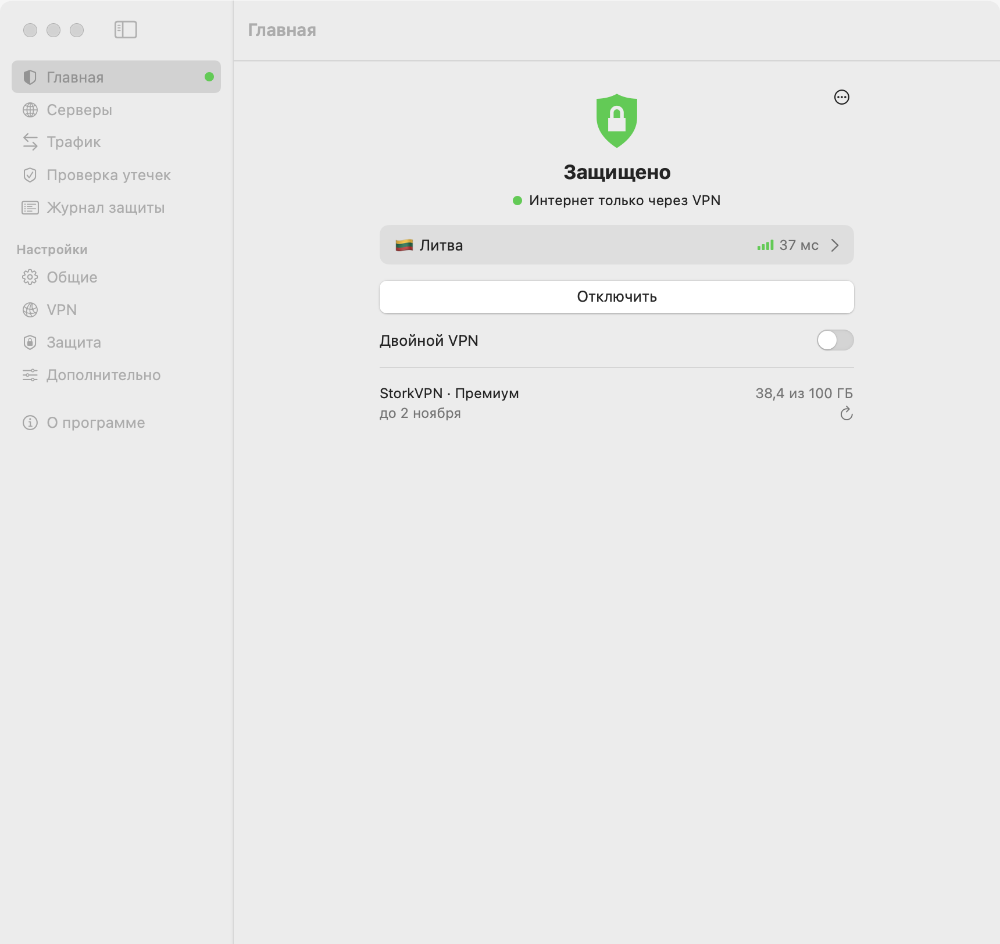
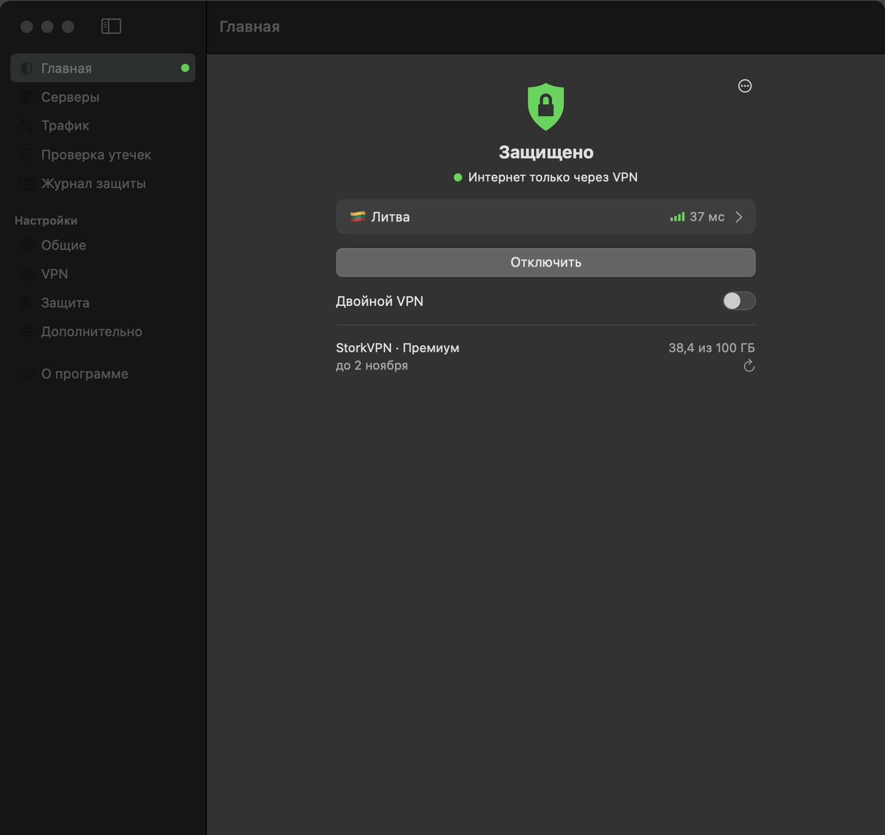

# KillSwitch

KillSwitch is a kill switch and VPN client for macOS. A root helper loads macOS packet-filter (pf)
rules at boot, before login, with a default-deny policy: nothing leaves the Mac through Wi-Fi or
Ethernet except the local network and the VPN tunnel (and the few server addresses the tunnel needs).
An optional content filter adds a second layer. It ships as a SwiftUI app with a menu bar icon, a
widget and a command-line tool, and it runs its own VPN cores (mihomo and Xray) on subscriptions from
Remnawave or any mihomo/Clash provider, on share links, or on a WireGuard config.

## Why

When a VPN connection drops, most Macs quietly fall back to the plain connection and apps keep
talking over your real IP. With KillSwitch on, a dropped VPN means apps lose internet instead of
leaking around the tunnel.

## Features

- Default-deny firewall (pf anchor `com.apple/killswitch`), loaded at boot and re-checked by a
  watchdog every 2 s; tampering is detected, the rules are restored and the event is logged.
- Built-in VPN client for our own cores: subscription URL (kept in the keychain, auto-updated every
  12 h by default, traffic and expiry shown), servers from share links (vless, trojan, ss, hysteria2,
  tuic, wireguard) or a wg-quick `.conf` (AmneziaWG fields supported).
- Server list with latency tests, a "best server" choice, and double VPN (chain through an entry server).
- Programs without VPN (split by app), blocked categories (ads, adult, social media, betting),
  your own DoH server, MTU setting for troubleshooting.
- Optional second layer: a content filter system extension that drops new flows while no tunnel is up.
- Leak test (public IPv4/IPv6 and DNS resolvers), protection log, non-secret diagnostics for support.
- Connect automatically on start and on network change, with trusted Wi-Fi networks; launch at login.
- Menu bar icon, WidgetKit widget with an on/off button, and the `killswitch` command line tool.
- Works alongside Tailscale and NetBird.
- Signed and notarized builds with automatic updates through Sparkle.

## Download

Get the latest signed and notarized build from
[GitHub Releases](https://github.com/lesha19/KillSwitch-releases/releases/latest). The app also updates
itself through Sparkle. Requires macOS 15.0 or later. Checksum and signature verification steps are
under [Development > Release](#release).

<p>
  
  
</p>

Note: the app's interface is in Russian for now.

## Security

The rules and settings are root-owned; turning protection off, pausing and changing settings ask for
the administrator password. The helper blocks everything on every interface except loopback, AirDrop
links and real VPN tunnels, and the watchdog restores tampered rules. What it cannot protect
against (for example anything already running as root) is listed in
[Known limits](#known-limits) and the [security model](#security-model). To report a vulnerability, see
[SECURITY.md](SECURITY.md). Audits are in [docs/security/](docs/security/).

## Build from source

```bash
xcodegen generate
xcodebuild -project KillSwitch.xcodeproj -scheme KillSwitch -configuration Release -derivedDataPath build -allowProvisioningUpdates build
cp -R build/Build/Products/Release/KillSwitch.app /Applications/
```

Then open the app and press «Начать настройку…» ("Start setup…") (or run `Helper/install.sh` in
Terminal; server addresses found in dropweb and Happ configs are passed to it). After updating the
app, press «Восстановить службу…» ("Restore service…") in Settings to upgrade the installed helper.

## License

MIT, see [LICENSE](LICENSE). Bundled cores (mihomo, Xray) keep their own licences, see
[App/ThirdPartyNotices.txt](App/ThirdPartyNotices.txt).

## Development

Maintainer and developer material.

### Parts

- `Helper/ks` — root helper: generates the pf rules from settings and loads them into anchor
  `com.apple/killswitch` (`/etc/pf.conf` untouched). `status | state | on | off | pause [min] |
  set lan|tailscale|dns|direct|wifiguard|adblock|blockadult|blocksocial|blockbetting 0|1 | set doh <url> | allow <addr> | unallow <addr> | server-add <ip> |
  server-remove <ip> | core … | apply | repair | watch`. Tests (no root, nothing on the system changes):
  `for t in Helper/tests/*.sh; do bash "$t"; done`. Before a push, also as CI runs them (no
  cores, no geodata, a copy of the tracked files): `scripts/test-helper-ci.sh /bin/bash` and
  `scripts/test-helper-ci.sh "$(brew --prefix)/bin/bash"`.
  Merge gate (Actions is not paid): `scripts/ci-local.sh <commit> [--pr N]` runs the ci.yml steps
  on a clean worktree of that commit; merge only on its `green`.
  `scripts/vm.sh <commit> [--pr N]` runs the same gate in two parallel parts: lint, xcodegen and `xcodebuild build test` on the host Mac (temp worktree), the network/pf/service tests inside the tart VM (never install or run the app on the host Mac).
  `scripts/vm-batch.sh check <base> <PR>...` gates a batch of reviewed PRs once (the merge of all of them onto the base tip; a red batch is bisected and the culprit left out), then they are squash-merged in that order
  and `scripts/vm-batch.sh landed <base> <tree>` must say the tip is the tested tree. Rules: docs/agents/done.md.
- `Helper/local.killswitch.plist` — LaunchDaemon: runs `ks watch` (RunAtLoad + KeepAlive), so rules
  are loaded at boot, before login, and checked every 2 s (tunnels every second). `AssociatedBundleIdentifiers` makes it
  show up under the app's name in System Settings → Login Items & Extensions.
- `Helper/install.sh [user] [server-ip ...]` / `uninstall.sh` — put everything into root-owned
  `/Library/KillSwitch`. install.sh is safe to re-run: it upgrades the helper in place and keeps
  `settings`, `allow` and `servers`. The app's «Восстановить службу…» (Settings) does exactly that.
- `Helper/local.killswitch.core.plist` + `Helper/mihomo` (downloaded by `Helper/fetch-mihomo.sh`, pinned
  version and sha256, not in git, then signed by `scripts/sign-core.sh` with our Developer ID or, without
  it, Apple Development, so the content filter trusts it) — our own VPN core, see below.
- `App/` — SwiftUI app: window, menu bar icon, settings, notifications, install / upgrade / uninstall,
  leak test, and the VPN client for our core: subscription URL (Remnawave or any mihomo/Clash
  subscription, kept in the keychain), auto-update by `profile-update-interval` (default 12 h), traffic
  and expiry from `subscription-userinfo`, servers added from share links (vless, trojan, ss, hysteria2,
  tuic, wireguard) or a wg-quick `.conf` (AmneziaWG fields → `amnezia-wg-option`, several `[Peer]` →
  `peers:`), server list with latency and selection (`ks core proxies` /
  `ks core select`), latency tests and «Лучший» ("Best") (`ks core delay <group>`), non-secret diagnostics. The subscription
  is fetched with a mihomo User-Agent and Remnawave's device headers (`x-hwid` = hash of the Mac's
  hardware UUID, `x-device-os`, `x-ver-os`, `x-device-model`), reduced to proxies, proxy-groups, rules
  and rule-providers and handed to the helper; a failed update keeps the old config. If the subscription's host does not answer,
  the app asks again through the core's loopback listener (127.0.0.1:47890, always through the VPN),
  and shows which way worked (ADR 0016; the backup link is gone, ADR 0036). A click (adding the
  subscription, «Обновить» ("Refresh"), a new server) runs `ks core import <file.json>`, with the admin prompt if
  needed. The timer only runs `sudo -n ks core refresh <file.json>` and never prompts; if the helper
  refuses it (exit 3: new server addresses) the app shows «Нужно подтверждение: в подписке новые
  серверы» and imports only after the user clicks «Подтвердить» ("Confirm"). The User-Agent starts with
  `mihomo/<core version>` (Remnawave's anchored Mihomo rule); `x-hwid-max-devices-reached` and
  `x-hwid-not-supported` are shown as device-limit errors.
  Also in the app: «Проверка утечек» ("Leak test") (public IPv4 from api.ipify.org and am.i.mullvad.net, IPv6 from
  ipv6.am.i.mullvad.net, DNS resolvers via the bash.ws API; the provider's address is remembered from a
  run with the VPN off and compared later); «Подключаться автоматически» ("Connect automatically") on start and network change,
  never prompting (a notification instead), with trusted Wi-Fi networks (the name needs Location access
  on macOS 14+; without it every network is untrusted); «Запускать при входе» ("Launch at login") (SMAppService);
  «Программы без VPN» ("Programs without VPN"; apps by CFBundleExecutable → `ks set splitapps <list>`);
  «Двойной VPN» ("Double VPN"; `ks set multihop <entry>|off`, chain shown in the window); «Размер пакетов VPN (MTU)»
  for troubleshooting (`ks set mtu auto|1280…1500`, ADR 0032).
- `App/Core/` — pure parsers (no AppKit), unit-tested by the `KillSwitchTests` target:
  `xcodegen generate && xcodebuild -scheme KillSwitch test CODE_SIGNING_ALLOWED=NO`.
- `CLI/` — `killswitch`, the command line over the daemon (ADR 0025), shipped at
  `KillSwitch.app/Contents/Helpers/killswitch`: `status [--json]`, `connect`, `disconnect`,
  `protection on|off`, `pause <min>`, `server list [--json]`, `server select <name>`. The same
  authorization as the app: `protection off` and `pause` ask for an administrator in macOS's dialog.
  The app does not put it on PATH; to call it as `killswitch`, link it yourself, e.g.
  `mkdir -p ~/bin && ln -s /Applications/KillSwitch.app/Contents/Helpers/killswitch ~/bin/killswitch`
  (with `~/bin` on PATH).
- `Widget/` — WidgetKit widget with on/off button. It is sandboxed, so its button posts a Darwin
  notification and the running app performs the switch; state reaches it via app group `YR58655PJ7.killswitch`.

### Words on screen

The app speaks Russian, without technical words: «VPN» (never core, mihomo, tunnel), «Защита»
(never pf, rules, filter), «Защита macOS» for the content filter, «Служба KillSwitch» for the root
helper, «Подписка», «Сервер», «Пинг», «Программы без VPN», «Адреса без VPN». The full dictionary
is in `docs/ux/audit.md` §7.2, the exact screens and strings in `docs/ux/spec.md`. All strings are
collected in `App/Localizable.xcstrings` (source language ru) for proofreading; Xcode refreshes it on
build, or by hand: `xcrun xcstringstool sync App/Localizable.xcstrings --stringsdata <file>…` with
the app target's `.stringsdata` files from DerivedData. Check before a release:
`rg -n 'ядр|pf |туннел|utun|mihomo|Clash|Remnawave|Обновить защиту' App/*.swift` — only comments
and code may match. Technical names stay in «Скопировать диагностику» (for support).

Root-owned files in `/Library/KillSwitch`: `settings` (key=value: lan, tailscale, dns, direct, wifiguard, adblock, blockadult, blocksocial, blockbetting, doh, splitapps, multihop, core, xrayserver, diag,
escalate, mtu; `ks set <key> 0|1` for the switches, `ks set mtu <n>|auto`),
`allow` (addresses reachable by any process), `servers-manual` (VPN server IPs added by `server-add`
and install.sh, reachable by any process), `servers-core` (proxy addresses of the imported core
profile, rewritten on every import, reachable only by our core), `servers` (both merged),
`rules.sha256`, `rules.files` and `tunnels` (state of the last load, for tamper checks), `invalid`
(world-readable: damaged files that made the last load block everything, ADR 0015), `events.log`
(world-readable, last 500 corrective actions), `core/geodata` (world-readable: whether install.sh put
the bundled geodata in place or kept the old file because its sha256 was not the pinned one, #27),
`core/escalation-state` and `core/escalation` (root-only: the escalation pass's state and
what transport escalation remembered per server, ADR 0030).

### Security model

- Default deny on every interface except loopback, AirDrop links and real VPN tunnels. A tunnel is a
  `utun` whose IPv4 address is in 198.18.0.0/16 (dropweb and Happ TUN both use 198.18.0.1), detected
  with `ifconfig` on every load. Other `utun` interfaces (iCloud Private Relay, other VPNs, a
  Tailscale exit node) get nothing. New interface types (iPhone USB, PPP, Thunderbolt) are covered
  automatically.
- VPN server addresses added by hand (`servers-manual`) are reachable by any process. That is needed
  for Happ, whose tunnel runs as the user and cannot be told apart from other apps. Only these
  addresses are open. The servers of our core's profile (`servers-core`) are open to the core only.
- The dropweb core is **not** trusted by default. DropwebCore is setuid root + setgid admin and is
  executable by anyone, so a rule on uid 0 / gid 80 would let any local program start it with its own
  config and escape. The rule exists only with `direct=1` ("Сайты мимо VPN через dropweb"), a weaker mode
  in which the core reaches any address. Without it dropweb still works through its servers; its DIRECT
  rules (Russian sites and so on) do not.
- Own VPN core (`ks core on|off|state|import <json>|refresh <json>|proxies|select|delay`): launchd runs `/Library/KillSwitch/core/mihomo` with
  a root-owned config as uid 0, gid `_ksvpn` (created by install.sh, no members, no setgid binary), and the
  rules let that gid reach only the addresses in `servers` (plus 1.1.1.1 and 8.8.8.8 on tcp 443, see
  rotation below). Routing is the subscription's (ADR 0013): the gid may reach any address only while
  `core/egress` (644) names a reason: the profile has DIRECT rules or group members (`rules`), its DNS
  policy reaches servers outside the tunnel (`dns`), or the user chose programs without VPN
  (`splitapps`); otherwise a DIRECT rule or proxy in a profile cannot leak past the tunnel. The app adds
  no site routing of its own. `import <json>` takes a
  mihomo profile as a JSON object (the app converts dropweb's newest from YAML) and generates the config:
  `proxies`, `proxy-groups`, `rules` and `rule-providers` are taken (rules mihomo cannot take are left
  out with a reason, not the whole import), from `sniffer` and `dns` only validated keys (ADR 0013;
  without a sniffer a routing-only default is added); everything else (TUN, DNS on
  127.0.0.1:53, the controller as a unix socket in root-only `core/ctl/`, no listeners or proxy ports)
  comes from a fixed template. The DoH resolvers and rule-provider downloads go through `KS-DNS`, a
  generated hidden fallback group over the profile's proxies only, so picking DIRECT in a profile group
  cannot take DNS out of the tunnel (a profile using the name `KS-DNS` is refused). Proxies of
  type direct/dns or unknown types, proxy-providers and file rule-providers are refused; WireGuard may
  carry `amnezia-wg-option` (passed through, checked by `mihomo -t`) and a `peers:` list, each peer's
  server pinned like any other (pf lets the core reach servers over TCP and UDP). A server given
  by host name is pinned to its address (`servername`/`sni` keep the name), resolved by our core or
  DoH (the system resolver only on a first import with no tunnel at all, logged), fake-ip answers
  refused; the addresses become
  `servers-core`. Import keeps root-only (600) in `core/`: the profile (`profile.json`, for rebuilds),
  the pins (`pins`) and what the admin approved: the host names (`approved-hosts`) and everything that
  can send traffic DIRECT (`approved-direct`: rules naming DIRECT, GLOBAL or COMPATIBLE or a group that
  can reach them, and those groups). `refresh <json>` does the same but is refused (exit 3, «нужно
  подтверждение») for a host name not in the last import, an address that is neither in `servers` nor
  the address of an approved name, or any change to the DIRECT set; it is passwordless, for subscription
  auto-update. Installs from before this have no record: their first refresh with DIRECT rules asks for
  one import.
  Server IP rotation: the watchdog re-resolves the approved names a minute after start, every 30 min and
  15 s after the primary interface or router changes (at most once a minute), in the background under
  the config lock. A name whose pinned address is no longer among its answers is re-pinned; the config
  is rebuilt from the kept profile, `servers-core`, `servers` and pf follow and the core rereads its
  config through the API (selections survive; restart if that fails). Logged in `events.log`. If every
  server of the profile moved at once, the tunnel that carries the lookups is gone too: when no approved
  name resolves the usual way, the names are asked once more by DoH straight to 1.1.1.1, then 8.8.8.8,
  bound to the primary interface and run with gid `_ksvpn` (logged). pf lets that gid reach exactly
  these two addresses on tcp 443 for this; the core's own DNS still goes through `KS-DNS`, and a profile
  rule sending them DIRECT needs the admin's approval like any DIRECT rule. Never the LAN's DNS.
  Programs without VPN: before the profile's rules the generator puts the apps of
  `ks set splitapps <a,b>` (stored as `splitapps=` in `settings`; ≤50 names, ≤64 bytes, no commas or
  control characters; also their `<name> Helper…` processes; `""` clears), DIRECT; blocked
  categories (ADR 0031: `adblock`, `blockadult`, `blocksocial`, `blockbetting` = `category-ads-all`,
  `category-porn`, `category-social-media-!cn`, `category-betting-ru`) go first as `GEOSITE,…,REJECT`;
  the own DoH server (`ks set doh <https url>`) is asked through the VPN only (Xray: Cloudflare DoH after it; mihomo: alone).
  Both are the user's own choices and are reported as such. `core/geosite.dat` and `core/geoip.metadb` (`Helper/fetch-geodata.sh`,
  sha256-pinned, shipped in the app) serve the profile's `GEOSITE`/`GEOIP` rules; without them such
  rules are left out. The core never downloads geodata (`geo-auto-update: false`).
  Every generation writes `core/routing.json` (644, no secrets): the rules in order, what was left out
  and why, what KillSwitch added, the sniffer and DNS taken, the egress reasons; the app's «Трафик»
  shows it. `ks core connections` (passwordless) gives the open connections (program, host, rule,
  route, bytes; no source addresses) for its «Соединения» tab. Double VPN: `ks set multihop <proxy>|off`
  (`multihop=` in `settings`) sets `dialer-proxy: <proxy>` on every other proxy, so pf lets the core
  reach only the entry server; the entry must be a proxy of the profile without its own dialer-proxy.
  Both need the admin password (not in sudoers: splitapps widens direct egress). The TUN's MTU:
  `ks set mtu auto|1280…1500` (`mtu=` in `settings`, admin, both cores; «auto» = Xray 1500, mihomo
  9000) rebuilds the config, restarts the core once and puts the previous value back if it does not
  come up (ADR 0032). The app switches servers without the API being exposed: `ks core proxies` (JSON of
  groups and proxies), `ks core select <group> <proxy>`, `ks core delay <group|proxy>` talk to the
  controller socket; names are length- and control-character-checked and fully percent-encoded.
  `Helper/tests/core-config.sh` runs the generator against fixture profiles, attack ones included,
  and checks the result with `mihomo -t`.
  `on` refuses while another VPN tunnel is up, then points the system DNS of every
  physical service to 127.0.0.1; `off` restores it. Like Mullvad, only the volatile dynamic store is
  written (`State:/Network/Service/<id>/DNS` of active and `Setup:/…/DNS` of all services on a
  physical port, ServerAddresses only), never the saved network preferences, so a crash cannot leave
  the Mac without names after a reboot; originals are kept in `core/dns-state` and restored only
  where 127.0.0.1 is still set. The watchdog sets it again when the system overwrites it (DHCP renew,
  network change), restores it when the core has not been running for 5 s or is unloaded, and puts
  back DNS left by older versions (`core/dns-saved`, set with networksetup) once.
  `Helper/tests/dns.sh` checks this against a fake store.
  If Happ or dropweb bring up their own TUN while the core runs (a utun other than ours, 198.18.128.1,
  with a default or /8-or-wider route), the watchdog logs it and writes the interface names to the
  world-readable `core/foreign-vpn` for the app to warn; other programs are not touched.
  Start/stop, proxies/select/delay and refresh are passwordless, import is not.
  Log: `/Library/KillSwitch/core/core.log`.
- Second layer (`Filter/`, optional, Settings → Общие): a content filter system extension
  (NEFilterDataProvider). It cannot see the outgoing interface, so it does not repeat pf: while no VPN
  tunnel is up it drops every new flow except to the LAN, to the addresses pf lets out (servers, Tailscale
  relays, exceptions) and from trusted programs. Those are recognised by code signature, never by path
  (`Filter/TrustedCode.swift`): our core signed by team YR58655PJ7 as `com.lesha19.KillSwitch.core`
  (`scripts/sign-core.sh`), Tailscale's app and network extension (Developer ID or App Store), NetBird (Developer ID). Ad-hoc
  and unsigned binaries never match, so Homebrew tailscaled and DropwebCore are not trusted by the
  filter (their traffic still passes to listed addresses; pf rules are unchanged). With a tunnel up it allows everything and leaves the rest to pf. The app
  keeps its lists in sync and turns it on and off with the protection. Signed with Apple Development:
  works on Macs registered in the team, not notarised.
- Tailscale: direct UDP and STUN only for root (system tailscaled); DERP relays and the control plane
  (`tsrelays`, regenerated by `Helper/update-tsrelays.sh`, TCP 80/443 and UDP 3478) for any process, since
  the App Store Tailscale runs as the user; with the Tailscale setting on, the
  tailnet itself (100.64.0.0/10, fd7a:115c:a1e0::/48) is allowed on Tailscale's utun, exit-node traffic is not.
- NetBird (same setting): its root daemon binds every connection to the physical interface and gets its
  relays from its management server, so no address list would hold. The watchdog adds `GroupName
  _ksnetbird` to `/Library/LaunchDaemons/netbird.plist` (only if the binary there is signed by NetBird
  GmbH, TA739QLA7A) and restarts it; pf lets that group out, the filter trusts the same signature.
  NetBird's network (100.64.0.0/10) passes on its utun like the tailnet.
- DNS to LAN resolvers is blocked by default (setting `dns`), so names do not leak via the router.
- The VPN on blocks like protection on (0.20.0, ADR 0035): from «Подключить» (`ks core on`) to
  «Отключить» (`ks core off`) `/Library/KillSwitch/vpn-on` exists, and pf blocks everything outside
  the tunnel whatever the protection switch or a pause say: a core restart (an update, a server
  switch, a crash, a reboot) never goes out directly. `/Library/KillSwitch/vpn-gap` holds the start
  of the current gap (the VPN on, not connected) for «Журнал защиты». Protection («защита») adds the
  same blocking while the VPN is off.
- Rules and settings are root-owned. Passwordless sudo covers only `ks state`, `ks on`, `ks core
  state|on|off|restart|proxies`, `ks core select|delay …`, `ks core refresh …` (refused if it brings new
  server names or addresses or changes what goes DIRECT) and `ks core use …` (another subscription's
  profile, refused unless one entry the last import approved takes all its servers and DIRECT; a
  profile of the other core swaps the core under blocking, ADR 0036), none of which can widen the rules; turning off, pausing, `ks core import` and
  every setting change ask for the admin password.
- Watchdog (`ks watch`, pf every 2 s and tunnels every second, honours off / pause while the VPN is off): checks that pf is enabled, that the main
  ruleset still references the `com.apple/*` anchor (otherwise it reports that the rules do not
  block and leaves the main ruleset alone: it never reloads or flushes it, #86), that the
  sha256 of the loaded anchor equals the hash saved right after our load, and that the set of tunnel
  interfaces did not change. Any mismatch reloads the rules and is written to `events.log`.
- The app warns (banner and notification) when the daemon is disabled in System Settings → Login Items
  & Extensions or is not loaded, and after a macOS update asks to reboot and re-check.
- Settings → "Проверка": tries `curl --interface en0` (and the default-route interface) to 1.1.1.1 as an
  ordinary user; a reply means a leak. It also shows the external IP and the tail of `events.log`.

What it does not protect against: anything already running as root (it can unload pf; the watchdog
restores the rules within 3 s and logs it, but this is detection, not prevention); the seconds of boot
before the LaunchDaemon runs (only system daemons are up then); dropweb's own rules in `direct=1` mode;
LAN hosts that act as proxies; anything that can reach a listed VPN server, if the server itself relays.


### Release

Builds for other Macs are distributed outside the App Store, like Mullvad and IVPN: the app needs a
root service and pf, which the App Store sandbox does not allow. Developer ID signature, hardened
runtime, Apple notarization, `.dmg`.

One-time setup:

1. Certificate: Xcode → Settings → Accounts → team YR58655PJ7 → Manage Certificates → "+" →
   **Developer ID Application**. The key stays in the login keychain.
2. Profiles: developer.apple.com has two Developer ID profiles, "KillSwitch Developer ID"
   (`com.lesha19.KillSwitch`: System Extension, Network Extensions) and "KillSwitch Filter Developer ID"
   (`com.lesha19.KillSwitch.Filter`: Network Extensions); both carry
   `content-filter-provider-systemextension`. Download them: Xcode → Settings → Accounts → YR58655PJ7 →
   **Download Manual Profiles** (they land in `~/Library/Developer/Xcode/UserData/Provisioning Profiles`,
   the script finds them itself; another path can be set in `KS_PROFILE_APP` / `KS_PROFILE_FILTER`).
   The widget needs no profile: it has no restricted entitlements and its app group starts with the
   team ID.
3. Notarization profile: create an app-specific password at appleid.apple.com → "Sign-In and Security"
   → "App-Specific Passwords", then in Terminal
   `xcrun notarytool store-credentials killswitch-notary --apple-id <Apple ID> --team-id YR58655PJ7`
   and enter the password when asked (never put it on the command line). It is stored in the keychain.
4. Cores: `Helper/fetch-xray.sh` (the main one, ADR 0020) and `Helper/fetch-mihomo.sh`; geodata for the
   subscription's GEOSITE/GEOIP rules and ad blocking: `Helper/fetch-geodata.sh` (the meta-rules-dat
   release and its sha256 are already pinned in the script; without `Helper/geosite.dat` and
   `Helper/geoip.metadb` the release will not build). The script first takes a copy of each file from
   the latest release of `lesha19/KillSwitch-releases` (`--publish` puts them there), and the pinned
   meta-rules-dat commit only if there is no copy or it has another sha256: meta-rules-dat rewrites its
   `release` branch, and the old commit may disappear.
5. Sparkle key: run `generate_keys` once from `build/spm/artifacts/sparkle/Sparkle/bin/` (it appears after
   the first build); the private EdDSA key goes into the login keychain, the public one
   (`generate_keys -p`) is already in `project.yml` as `SUPublicEDKey`.
6. Backups; without them new versions cannot be released:
   - Sparkle key: `generate_keys -x <file>` exports the private key, `generate_keys -f <file>` restores
     it on another Mac. If you lose it, installed copies will accept no further updates;
   - Developer ID key: Keychain Access → My Certificates → "Developer ID Application: … (YR58655PJ7)"
     → Export… to a `.p12` with a password (the certificate together with its private key). Without
     the private key the certificate has to be issued again.
   Keep both copies away from this Mac (an encrypted disk or a password manager), not in the repository.

Releasing: `scripts/release.sh`. It first checks everything listed above and builds nothing without it
(`scripts/release.sh --check` only checks), then builds Release, signs from the inside out (the core as
`com.lesha19.KillSwitch.core`, the widget, the filter, the app with Developer ID entitlements and
embedded profiles), submits for notarization, staples the ticket (`stapler`) and produces a signed,
notarized `build/release/KillSwitch-<version>.dmg`. `scripts/release.sh --sign-only` only builds and
signs the app, without notarization. The system extension is enabled only when the app is in
/Applications.

Besides the `.dmg`, a release produces `build/release/appcast.xml` for Sparkle, signed with the EdDSA key.
`scripts/release.sh --publish` does the same, then runs `gh release create v<version>` in
`lesha19/KillSwitch-releases` with the `.dmg`, `appcast.xml`, a copy of `geosite.dat` (with
`geosite.dat.sha256`), the sources of the pinned core tags (`mihomo-<tag>-source.tar.gz`, because
GPL-3.0 requires them next to the binary; `Xray-core-<tag>-source.tar.gz`; sha256 pinned as
`SOURCE_SHA256` in `Helper/fetch-mihomo.sh` and `Helper/fetch-xray.sh`) and `SHA256SUMS` of all of them;
the description comes from the "## <version>" section of `CHANGELOG.md` (or from the file in
`KS_RELEASE_NOTES`). Needs `gh` logged in with access to that repository. The app reads
`releases/latest/download/appcast.xml`, so a published release becomes an update for everyone at once.

Beta: `KS_CHANNEL=beta scripts/release.sh --publish`. The release is created as a pre-release (it does
not become "latest"), and its entry with `<sparkle:channel>beta</sparkle:channel>` is appended to the
`appcast.xml` of the latest regular release (and its `SHA256SUMS` is recomputed). Only people who turned
on «Бета-версии» ("Beta versions") in «О программе» ("About") get it; the next regular release removes
the beta entry.

#### Verifying a download

Every release in `lesha19/KillSwitch-releases` carries `SHA256SUMS`: sums of the `.dmg`, `appcast.xml`,
`geosite.dat`, `geoip.metadb` and the core sources. Download the `.dmg` and `SHA256SUMS` into one
folder and in it run:

```bash
shasum -a 256 -c SHA256SUMS --ignore-missing      # KillSwitch-<version>.dmg: OK
spctl -a -t open --context context:primary-signature -v KillSwitch-<version>.dmg
                                                  # accepted, source=Notarized Developer ID
codesign -dv /Volumes/KillSwitch\ <version>/KillSwitch.app 2>&1 | grep TeamIdentifier
                                                  # TeamIdentifier=YR58655PJ7
```

The sums sit next to the files, so they protect against a corrupted or swapped download, but not
against a swapped release. The signature protects against that: the app and the image are signed with
the team's Developer ID (`YR58655PJ7`) and notarized by Apple, and Sparkle updates also carry an EdDSA
signature whose public key is built into the app (`SUPublicEDKey`). It is worth comparing the sums with
the ones `scripts/release.sh` prints at the end of a release.

### Emergency off

```bash
sudo pfctl -a com.apple/killswitch -F all
```

### Known limits

- Happ's direct sites (Russian, Apple, Steam) do not open while it is on: only VPN server addresses are open.
- Captive Wi-Fi portals: use pause.
- Tailscale: direct UDP only from system tailscaled; the App Store app goes through DERP relays away from home.
  Exit nodes are blocked. If Tailscale adds relays, run `Helper/update-tsrelays.sh` and "Обновить защиту".
- VM networks outside private ranges (e.g. OrbStack 198.19.0.0/16) are blocked.
- iCloud Private Relay can bypass the filter: turn it off.
- After every macOS update reboot the Mac and run the leak test; system updates may replace `/etc/pf.conf`
  or change how pf behaves.
- At boot, protection starts when launchd starts the daemon; for full protection switch Wi-Fi off before
  shutting the Mac down.
- If the daemon is switched off in System Settings, the rules stay but nothing watches them.
